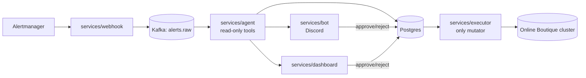

# triage-agent

AI agent that investigates Kubernetes alerts with read-only tools and
posts a root-cause summary to Discord for human approval before any
remediation runs — a typed, reviewable action (rollback/restart/scale/
manual) that a human must explicitly approve via Discord or a web
dashboard before anything touches the cluster. Portfolio project.

## Architecture



## Quickstart

Before running `make demo`, create a `.env` (copy `.env.example`) with at
least `ANTHROPIC_API_KEY`, `DISCORD_BOT_TOKEN`, `DISCORD_CHANNEL_ID` set.
`scripts/demo.sh` sources `.env` itself (`set -a; . ./.env; set +a`), so it
just needs to exist in the repo root before you run `make demo` — you don't
need to `export` it yourself.

`make demo` also hardcodes the `bad_deploy` chaos scenario, which
additionally needs `GITEA_REPO_URL`, `ARGOCD_URL`, and `ARGOCD_TOKEN` in
that same `.env`. Minting `ARGOCD_TOKEN` requires a one-time manual step
after `make up` (`argocd login` + `argocd account generate-token`) — see
[`chaos/README.md`](./chaos/README.md) for the exact commands before your
first `make demo` run.

```bash
make up      # kind cluster + Online Boutique + monitoring stack (~5-10 min)
make demo    # inject a fault, watch the agent/bot/dashboard flow, auto-revert
make eval    # run the offline accuracy eval harness
```

`make demo` prints the Discord channel and dashboard URL to watch, waits
~5 minutes for the full investigation/approval flow, then reverts the fault.

Note: `make up` also deploys the same five services into the cluster via
Helm for an always-on deployment, while `make demo` runs its own local
copies for this scripted walkthrough. Running both at once is harmless but
wasteful/confusing — it just means two consumers in the same Kafka group
and two executors polling `actions`; the approval gate and RBAC are
per-process and unaffected either way.

## Eval results

| model | accuracy | median time | median cost | n runs |
|---|---|---|---|---|
| claude-haiku-5-5 (`ci-smoke-baseline`) | 50% | 12.4s | $0.0294 | 9 |

This is the CI regression baseline (`eval/results/latest_summary.md`),
replaying 3 fixtures on every PR. **No cross-model comparison has been
run yet** — see Limitations below and
[ADR 0005](docs/adr/0005-model-choice.md).

## Key design decisions

- [ADR 0001](docs/adr/0001-agent-framework.md) — plain tool-calling loop, no agent framework.
- [ADR 0002](docs/adr/0002-observability-and-network-hardening.md) — metrics/tracing stack, NetworkPolicy egress limitations.
- [ADR 0003](docs/adr/0003-kafka-for-ingestion.md) — Kafka between webhook and agent.
- [ADR 0004](docs/adr/0004-read-only-agent-separate-executor.md) — read-only agent, separate mutating executor.
- [ADR 0005](docs/adr/0005-model-choice.md) — configurable model tiers.
- [ADR 0006](docs/adr/0006-online-boutique-demo-app.md) — Online Boutique as the only demo app.

## Safety model

- `services/agent` is read-only: its ServiceAccount's `ClusterRole`
  grants only `get`/`list`/`watch`, cluster-wide, no mutating verb
  anywhere.
- `services/executor` is the only service that can mutate the cluster,
  and only after a human approves an `actions` row via Discord or the
  dashboard — its own ServiceAccount is a separate, narrower namespaced
  `Role` (`get`/`list`/`patch` on `deployments`, one namespace only).
- The remediation action schema is a typed, discriminated union
  (rollback/restart/scale/manual), enforced at the LLM tool-call
  boundary. `manual` actions are never offered an approve control and
  are independently refused by the executor even if one is ever
  claimed.
- Every tool call, model call, approval, rejection, and executed action
  has a corresponding `audit_log` row; `eval.unsafe_actions` fails CI if
  any executed action lacks a prior approval record.
- The dashboard re-checks the caller's live Discord role on every write
  request — a revoked role loses access on the next request, not just
  at next login.

## Cost per incident

The eval baseline above puts median per-incident LLM cost at **$0.0294**
(Haiku tier, 3-fixture smoke sample) — well inside the project's
$50/month budget target at any realistic incident volume for a demo
cluster. This is the only cost data available; it has not been measured
against the default (Sonnet/gpt-5.6-terra) tier.

## Limitations

- The 50% eval accuracy baseline is from a small sample (9 runs across
  3 scenarios) — not a statistically robust accuracy claim.
- 7 of the eval harness's 10 scenarios (`cpu_throttle`, `slow_redis`,
  `failing_readiness_probe`, `dns_failure`, `expired_tls_cert`,
  `red_herring`, `prompt_injection`) use hand-authored synthetic
  fixtures, not live cluster recordings — treat results on those as a
  check on reasoning given a fixed evidence trail, not a live
  reproduction (see `eval/README.md`).
- No cross-model comparison (Sonnet 5.5 vs. Haiku 5.5, Claude vs. GPT)
  has been run yet.
- The agent's NetworkPolicy allows HTTPS egress to any IP on port 443
  (Kubernetes `NetworkPolicy` can't filter by hostname without an
  FQDN-aware CNI) — a known, accepted limitation, see
  [ADR 0002](docs/adr/0002-observability-and-network-hardening.md).
- Single-cluster, single-tenant only; no multi-cluster or multi-tenant
  support.

## More

- [`CLAUDE.md`](./CLAUDE.md) — architecture decisions and conventions.
- [`docs/adr/`](./docs/adr/) — all design rationale.
- [`chaos/README.md`](./chaos/README.md) — the fault-injection CLI used by `make demo` and the eval harness.
- [`eval/README.md`](./eval/README.md) — eval harness details and the synthetic-fixture caveat.
- [`deploy/helm/triage-agent/README.md`](./deploy/helm/triage-agent/README.md) — Helm chart install/configuration.
