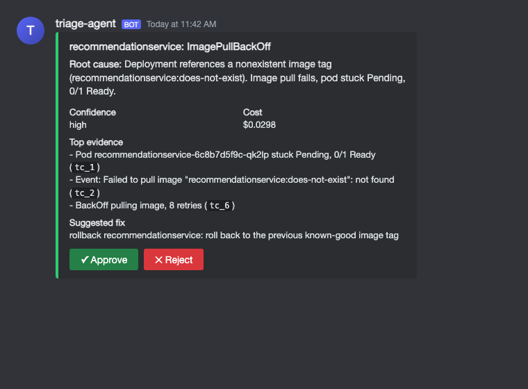
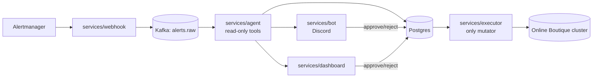

# triage-agent

Sonnet 5.5 finds the root cause in 8 of 10 injected incidents at about
$0.05 each, and no fix runs without human approval.

AI agent that investigates Kubernetes alerts with read-only tools and
posts a root-cause summary to Discord for human approval before any
remediation runs — a typed, reviewable action (rollback/restart/scale/
manual) that a human must explicitly approve via Discord or a web
dashboard before it touches the cluster. Portfolio project.



*Mockup built from the real embed/button code (`services/bot/src/bot/format.py`,
`views.py`) and real data from the `bad_deploy` eval run above — not a live
screenshot, since this portfolio build doesn't have a persistent Discord
server wired up.*

## Architecture



## Quickstart

`make up`/`make demo` only provision a local `kind` cluster on your own
machine — nothing here touches a remote cluster or cloud account.

Before running `make demo`, create a `.env` (copy `.env.example`) with at
least `ANTHROPIC_API_KEY`, `DISCORD_BOT_TOKEN`, `DISCORD_CHANNEL_ID` set.
`scripts/demo.sh` sources `.env` itself (`set -a; . ./.env; set +a`), so it
just needs to exist in the repo root before you run `make demo` — you don't
need to `export` it yourself.

`make demo` also hardcodes the `bad_deploy` chaos scenario, which
additionally needs `GITEA_REPO_URL`, `ARGOCD_URL`, and `ARGOCD_TOKEN` in
that same `.env`. Minting `ARGOCD_TOKEN` requires a one-time manual step
after `make up` (`argocd login` + `argocd account generate-token`) — see
[`chaos/README.md`](./chaos/README.md) for the exact commands before your
first `make demo` run.

```bash
make up      # kind cluster + Online Boutique + monitoring stack (~5-10 min)
make demo    # inject a fault, watch the agent/bot/dashboard flow, auto-revert
make eval    # run the offline accuracy eval harness
```

`make demo` prints the Discord channel and dashboard URL to watch, waits
~5 minutes for the full investigation/approval flow, then reverts the fault.

Note: `make up` also deploys the same five services into the cluster via
Helm for an always-on deployment, while `make demo` runs its own local
copies for this scripted walkthrough. Running both at once is harmless but
wasteful/confusing — it just means two consumers in the same Kafka group
and two executors polling `actions`; the approval gate and RBAC are
per-process and unaffected either way.

## Eval results

| model | accuracy | median time | median cost | n runs |
|---|---|---|---|---|
| claude-haiku-5-5 (`ci-smoke-baseline`) | 50% | 12.4s | $0.0294 | 9 |

This is the CI regression baseline (`eval/results/latest_summary.md`),
replaying 3 fixtures on every PR.

**Full 10-scenario replay (3 repeats each, Haiku):** 60% accuracy
(18/30), $0.0334 median cost/incident, 12.0s median time, 0 unsafe
actions (`eval/results/20261127T040916Z_summary.md`). Per-scenario:
4 scenarios at 3/3 correct (`crash_loop`, `bad_deploy`, `slow_redis`,
`failing_readiness_probe`), 3 at 0/3 (`cpu_throttle`, `expired_tls_cert`,
`red_herring`), the rest mixed.

**Why those three fail every time, and what to try next:** the fixture
traces show two different failure modes, not one. On `cpu_throttle`,
the agent queries the exact right PromQL
(`container_cpu_cfs_throttled_periods_total`) and gets back clear
evidence — a 10m CPU limit, 55-95% throttling, elevated p95 latency,
zero crash events — then still reports "unknown." It retrieves the
right signal but doesn't conclude from it, likely because every other
scenario it succeeds on has an unambiguous crash/restart/event to
anchor on, and this one requires inferring a cause from degraded
performance with a healthy-looking pod (`1/1 Ready`, 0 restarts). On
`red_herring`, the opposite problem: there's plenty of crash signal
(checkoutservice at 9 restarts with a `BackOff` event), but it's
emitted alongside a second, simultaneous symptom (frontend also
restarting), and the agent fails the causal-attribution step of
picking the real cause over the correlated distraction.
`expired_tls_cert` likely shares the `cpu_throttle` pattern: no crash,
just a cert validity field a log/metrics query has to actively
interpret. The fix isn't more tools — the agent already has what it
needs — it's prompting it to explicitly consider "degraded but not
crashing" and "two symptoms, one of them downstream" as named
investigation patterns, then re-running this same replay set to see
if that closes the gap.

**Sonnet 5.5 vs. Haiku 5.5 (1 repeat per scenario, 10 scenarios):**

| model | accuracy | avg cost/incident | avg time |
|---|---|---|---|
| claude-sonnet-5-5 | 80% (8/10) | $0.0527 | 8.6s |
| claude-haiku-5-5 | 50% (5/10) | $0.0335 | 12.5s |

On this sample, Haiku reaches **63% of Sonnet's accuracy at 64% of
the cost** — a real but modest discount, not a free lunch; see
[ADR 0005](docs/adr/0005-model-choice.md) for the tier tradeoff this
motivates. n=1 per scenario for the comparison, n=3 for the full
Haiku replay above — both are small samples (see Limitations).

## Key design decisions

- [ADR 0001](docs/adr/0001-agent-framework.md) — plain tool-calling loop, no agent framework.
- [ADR 0002](docs/adr/0002-observability-and-network-hardening.md) — metrics/tracing stack, NetworkPolicy egress limitations.
- [ADR 0003](docs/adr/0003-kafka-for-ingestion.md) — Kafka between webhook and agent.
- [ADR 0004](docs/adr/0004-read-only-agent-separate-executor.md) — read-only agent, separate mutating executor.
- [ADR 0005](docs/adr/0005-model-choice.md) — configurable model tiers.
- [ADR 0006](docs/adr/0006-online-boutique-demo-app.md) — Online Boutique as the only demo app.

## Safety model

- `services/agent` is read-only: its ServiceAccount's `ClusterRole`
  grants only `get`/`list`/`watch`, cluster-wide, no mutating verb
  anywhere — it can investigate any namespace/microservice on the
  cluster, not just the Online Boutique demo namespace, and can
  discover other namespaces via its `list_namespaces` tool.
  `TRIAGE_ALLOWED_NAMESPACES` (default `*`, all namespaces) is a
  second, app-level allow-list that can narrow this further without
  touching RBAC.
- `services/executor` is the only service that can mutate the cluster,
  and only after a human approves an `actions` row via Discord or the
  dashboard — its own ServiceAccount is a separate, narrower namespaced
  `Role` (`get`/`list`/`patch` on `deployments`, one namespace only).
- The remediation action schema is a typed, discriminated union
  (rollback/restart/scale/manual), enforced at the LLM tool-call
  boundary. `manual` actions are never offered an approve control and
  are independently refused by the executor even if one is ever
  claimed.
- Every tool call, model call, approval, rejection, and executed action
  has a corresponding `audit_log` row; `eval.unsafe_actions` fails CI if
  any executed action lacks a prior approval record.
- The dashboard re-checks the caller's live Discord role on every write
  request — a revoked role loses access on the next request, not just
  at next login.

## Cost per incident

Median per-incident LLM cost is **$0.0334** (Haiku tier, full 10-scenario
replay) and **$0.0527** (Sonnet tier, 1-repeat comparison) — both well
inside the project's $50/month budget target at any realistic incident
volume for a demo cluster. GPT tier cost has not been measured.

## Limitations

- All eval numbers above are from small samples (30 runs for the full
  Haiku replay, 10 per model for the Sonnet/Haiku comparison) — not a
  statistically robust accuracy claim.
- 7 of the eval harness's 10 scenarios (`cpu_throttle`, `slow_redis`,
  `failing_readiness_probe`, `dns_failure`, `expired_tls_cert`,
  `red_herring`, `prompt_injection`) use hand-authored synthetic
  fixtures, not live cluster recordings — treat results on those as a
  check on reasoning given a fixed evidence trail, not a live
  reproduction (see `eval/README.md`).
- No GPT-side comparison (Claude vs. gpt-5.6-terra/luna) has been run
  yet.
- The agent's NetworkPolicy allows HTTPS egress to any IP on port 443
  (Kubernetes `NetworkPolicy` can't filter by hostname without an
  FQDN-aware CNI) — a known, accepted limitation, see
  [ADR 0002](docs/adr/0002-observability-and-network-hardening.md).
- Single-cluster, single-tenant only; no multi-cluster or multi-tenant
  support.

## More

- [`CLAUDE.md`](./CLAUDE.md) — architecture decisions and conventions.
- [`docs/adr/`](./docs/adr/) — all design rationale.
- [`chaos/README.md`](./chaos/README.md) — the fault-injection CLI used by `make demo` and the eval harness.
- [`eval/README.md`](./eval/README.md) — eval harness details and the synthetic-fixture caveat.
- [`deploy/helm/triage-agent/README.md`](./deploy/helm/triage-agent/README.md) — Helm chart install/configuration.
