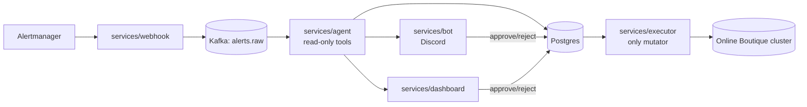

# Public Release Prep Implementation Plan

> **For agentic workers:** REQUIRED SUB-SKILL: Use superpowers:subagent-driven-development (recommended) or superpowers:executing-plans to implement this plan task-by-task. Steps use checkbox (`- [ ]`) syntax for tracking.

**Goal:** Take `triage-agent` from "stub demo, no Helm chart, 2 ADRs, no LICENSE" to a repo a stranger can clone and run end-to-end via the README alone: a working `make demo`, a Helm chart (with Dockerfiles to back it) covering all five services, three new ADRs, a cleanup pass, and a README + blog post describing the real, current state.

**Architecture:** Dependency-ordered tasks: Dockerfiles and the demo script first (they're needed to validate everything downstream actually runs), then the Helm chart (supersedes the raw `deploy/k8s/` app manifests and `make up`'s RBAC `kubectl apply` calls), then the three new ADRs (pure documentation, no code dependency), then a cleanup pass (lint/type/test gates plus LICENSE/CONTRIBUTING), then the README and blog post last, since both describe the demo, eval numbers, and Helm chart that must already exist and be real.

**Tech Stack:** Python 3.12, `uv` workspace, FastAPI (webhook, dashboard), Kafka (`confluent_kafka`), SQLAlchemy/Postgres, Helm 3, Docker, `ruff` + `mypy --strict`, `pytest`, Vite/React/TypeScript (`dashboard/`, untouched by this plan except as a cleanup gate), `discord.py` (bot).

**Spec:** `docs/superpowers/specs/2026-10-23-public-release-design.md`

## Global Constraints

- `uv` workspace: always use `--all-packages` for cross-package commands (`uv sync --all-packages`, `uv run --all-packages pytest`), except when a command intentionally targets one member (`uv run --package <name> ...`). The root `pyproject.toml` has no dependencies of its own.
- No `services/*/tests` directory gets an `__init__.py` — collides with root `tests/__init__.py` under pytest's prepend import mode. Always verify new test files against `uv run --all-packages pytest` with no path argument, not just a package-scoped run.
- `ruff` + `mypy --strict` enforced repo-wide, including test files.
- `dashboard/` is a separate npm/Vite/TypeScript app, not part of the `uv` workspace; its checks (`npx tsc -b`, `npx vitest run`) run from inside `dashboard/`.
- Agent (`services/agent`) RBAC is read-only (`get`/`list`/`watch`), cluster-wide. Executor (`services/executor`) RBAC is a namespaced `Role` (`get`/`list`/`patch` on `deployments` only) in the executor's target namespace (default `boutique`), never cluster-wide, never merged with the agent's identity.
- A `manual`-typed remediation action is never executable by any UI or by `services/executor` — not touched by this plan (already implemented), but no new code added here may contradict it.
- Never commit secrets. `.env` stays gitignored; only `.env.example` (placeholders) is committed. Any templated Helm `Secret` is for local/demo convenience only (`existingSecretName` is the production path).
- Commits: small, atomic, one logical change each — one commit per task below.
- Model choice stays a config value (env var / Helm values), never hardcoded in agent logic.

## Review Focus

- **`make demo` run against a cluster that isn't up yet** (no `make up` run, or `make up` run against a different cluster context): the script must fail with a clear, actionable message pointing at `make up`, not hang on a port-forward or silently connect to the wrong cluster.
- **`make demo` interrupted mid-run (Ctrl-C) or a step fails partway** (e.g. `chaos inject` succeeds but a service fails to start): every background process and port-forward the script itself started must still be killed on exit — a `trap`-based cleanup, not cleanup code only in the success path.
- **Helm chart installed with no `existingSecretName` and empty `secrets` values** (the exact state a first-time cloner lands in before editing `values.yaml`): `helm install`/`helm lint` must not crash outright — missing required secret values should surface as a clear pod-level failure (`CrashLoopBackOff` from a missing env var) or an explicit `fail` in the template with a readable message, not an opaque Helm templating error.
- **Executor's Role templated against a `targetNamespace` that doesn't exist yet** (fresh cluster, Online Boutique not deployed to that namespace): `helm install` for the chart itself must still succeed — Kubernetes allows a `Role`/`RoleBinding` to reference a namespace that doesn't exist yet at apply time (the namespace just needs to exist by the time the executor actually tries to act in it) — call this out explicitly in the chart README and don't add any precondition that would make it fail.
- **A stale `latest_summary.md` baseline check in cleanup** — the cleanup pass's lint/type/test gates must not be satisfied by silently regenerating or overwriting `eval/results/latest_summary.md`; that file is a deliberate, hand-updated CI baseline (per `eval/README.md`), and no task in this plan should run `make eval` against a live cluster and commit its output over the existing baseline.

---

## File Structure

```text
deploy/
  webhook/Dockerfile
  agent/Dockerfile
  bot/Dockerfile
  executor/Dockerfile
  dashboard/Dockerfile          # dashboard SERVICE (FastAPI), not dashboard/ (the Vite frontend)
  helm/
    triage-agent/
      Chart.yaml
      values.yaml
      README.md
      templates/
        _helpers.tpl
        serviceaccount-agent.yaml
        clusterrole-agent.yaml
        clusterrolebinding-agent.yaml
        serviceaccount-executor.yaml
        role-executor.yaml
        rolebinding-executor.yaml
        networkpolicy-agent.yaml
        networkpolicy-executor.yaml
        deployment-webhook.yaml
        deployment-agent.yaml
        deployment-bot.yaml
        deployment-executor.yaml
        deployment-dashboard.yaml
        service-webhook.yaml
        service-agent.yaml
        service-dashboard.yaml
        servicemonitor-agent.yaml
        secret.yaml
scripts/
  demo.sh
docs/adr/
  0003-kafka-for-ingestion.md
  0004-read-only-agent-separate-executor.md
  0005-model-choice.md
  0006-online-boutique-demo-app.md
docs/blog.md
README.md                        # rewritten
LICENSE
CONTRIBUTING.md
Makefile                         # demo target points at scripts/demo.sh; up target's RBAC/app-service lines replaced by helm upgrade --install
deploy/k8s/                       # deployment-agent.yaml, deployment-executor.yaml, service-agent.yaml,
                                   # rbac-triage-agent.yaml, rbac-triage-executor.yaml, networkpolicy-agent.yaml,
                                   # networkpolicy-executor.yaml, grafana-dashboard-agent.yaml, secrets-example.yaml
                                   # all DELETED (superseded by deploy/helm/triage-agent/); kind-config.yaml,
                                   # gitea-values.yaml, argocd-boutique-app.yaml, README.md stay
```

---

## Task 1: Dockerfiles for all five services

**Files:**
- Create: `deploy/webhook/Dockerfile`
- Create: `deploy/agent/Dockerfile`
- Create: `deploy/bot/Dockerfile`
- Create: `deploy/executor/Dockerfile`
- Create: `deploy/dashboard/Dockerfile`
- Test: manual (`docker build`), no pytest — this task has no Python test surface

**Interfaces:**
- Consumes: the existing `uv` workspace (`pyproject.toml`, `uv.lock`), each service's existing `src/<pkg>/main.py` entrypoint, each service's existing `pyproject.toml` `[project] name` (`triage-webhook`, `triage-agent-svc`, `triage-bot`, `triage-executor`, `triage-dashboard`).
- Produces: five buildable images — `triage-webhook`, `triage-agent`, `triage-bot`, `triage-executor`, `triage-dashboard` — that Task 4 (Helm chart) references via `image.repository`/`image.tag` values, and that `scripts/demo.sh` (Task 2) does **not** need (the demo runs services locally via `uv run`, not via these images).

All five Dockerfiles follow the same two-stage pattern. Only the final `CMD` and exposed port differ. webhook and dashboard run FastAPI apps via `uvicorn`; agent, bot, executor run their `main.py` as long-lived loops.

- [ ] **Step 1: Write `deploy/webhook/Dockerfile`**

```dockerfile
FROM python:3.12-slim AS base
RUN pip install --no-cache-dir uv
WORKDIR /app
COPY pyproject.toml uv.lock ./
COPY db ./db
COPY llm ./llm
COPY obs ./obs
COPY services/webhook ./services/webhook
RUN uv sync --frozen --package triage-webhook --no-dev
EXPOSE 8000
CMD ["uv", "run", "--package", "triage-webhook", "uvicorn", "webhook.main:app", "--host", "0.0.0.0", "--port", "8000"]
```

- [ ] **Step 2: Write `deploy/dashboard/Dockerfile`**

```dockerfile
FROM python:3.12-slim AS base
RUN pip install --no-cache-dir uv
WORKDIR /app
COPY pyproject.toml uv.lock ./
COPY db ./db
COPY llm ./llm
COPY obs ./obs
COPY services/dashboard ./services/dashboard
RUN uv sync --frozen --package triage-dashboard --no-dev
EXPOSE 8000
CMD ["uv", "run", "--package", "triage-dashboard", "uvicorn", "dashboard.main:app", "--host", "0.0.0.0", "--port", "8000"]
```

- [ ] **Step 3: Write `deploy/agent/Dockerfile`**

```dockerfile
FROM python:3.12-slim AS base
RUN pip install --no-cache-dir uv
WORKDIR /app
COPY pyproject.toml uv.lock ./
COPY db ./db
COPY llm ./llm
COPY obs ./obs
COPY services/agent ./services/agent
RUN uv sync --frozen --package triage-agent-svc --no-dev
EXPOSE 9100
CMD ["uv", "run", "--package", "triage-agent-svc", "python", "-m", "agent.main"]
```

- [ ] **Step 4: Write `deploy/bot/Dockerfile`**

```dockerfile
FROM python:3.12-slim AS base
RUN pip install --no-cache-dir uv
WORKDIR /app
COPY pyproject.toml uv.lock ./
COPY db ./db
COPY llm ./llm
COPY obs ./obs
COPY services/bot ./services/bot
RUN uv sync --frozen --package triage-bot --no-dev
CMD ["uv", "run", "--package", "triage-bot", "python", "-m", "bot.main"]
```

- [ ] **Step 5: Write `deploy/executor/Dockerfile`**

```dockerfile
FROM python:3.12-slim AS base
RUN pip install --no-cache-dir uv
WORKDIR /app
COPY pyproject.toml uv.lock ./
COPY db ./db
COPY llm ./llm
COPY obs ./obs
COPY services/executor ./services/executor
RUN uv sync --frozen --package triage-executor --no-dev
CMD ["uv", "run", "--package", "triage-executor", "python", "-m", "executor.main"]
```

- [ ] **Step 6: Verify each service's `main.py` actually exposes the module path used above**

Run: `grep -n "if __name__" services/agent/src/agent/main.py services/bot/src/bot/main.py services/executor/src/executor/main.py`
Expected: each prints a line like `if __name__ == "__main__":` — confirms `python -m <pkg>.main` is the correct invocation (already verified during planning; re-confirm before building).

- [ ] **Step 7: Build all five images locally to confirm each Dockerfile is valid**

Run (from repo root):
```bash
docker build -f deploy/webhook/Dockerfile -t triage-webhook:local .
docker build -f deploy/dashboard/Dockerfile -t triage-dashboard:local .
docker build -f deploy/agent/Dockerfile -t triage-agent:local .
docker build -f deploy/bot/Dockerfile -t triage-bot:local .
docker build -f deploy/executor/Dockerfile -t triage-executor:local .
```
Expected: all five builds succeed (exit 0). If `uv sync --frozen` fails on any package due to a missing workspace dependency, add the missing `COPY` line for that dependency (e.g. a service that imports `chaos` would need `COPY chaos ./chaos` too — check each service's `pyproject.toml` `[tool.uv.sources]`/dependencies first).

- [ ] **Step 8: Commit**

```bash
git add deploy/webhook/Dockerfile deploy/dashboard/Dockerfile deploy/agent/Dockerfile deploy/bot/Dockerfile deploy/executor/Dockerfile
git commit -m "build: add Dockerfiles for all five services"
```

---

## Task 2: `scripts/demo.sh` and `make demo`

**Files:**
- Create: `scripts/demo.sh`
- Modify: `Makefile:107-108` (the `demo:` target)
- Test: manual end-to-end run against a live `make up` cluster (documented in Testing/verification below) — no pytest, this is a shell script

**Interfaces:**
- Consumes: `uv run --all-packages chaos inject bad_deploy --service <target>` / `chaos status` / `chaos revert` (existing `chaos` CLI, see `chaos/README.md`); each service's existing `uv run --package <name> ...` invocation (same as Task 1's Dockerfile `CMD` lines, but run directly on the host, not containerized); `DISCORD_CHANNEL_ID` and dashboard port from the environment (`.env`).
- Produces: a `make demo` target that is the literal command the README's quickstart and the 2-minute demo video follow — no other task depends on its internals, but the README (Task 6) references its exact printed output format.

- [ ] **Step 1: Write `scripts/demo.sh` — cluster check and setup**

```bash
#!/usr/bin/env bash
set -euo pipefail

CLUSTER_NAME="triage"
DEMO_SERVICE="${DEMO_SERVICE:-cartservice}"
LOG_DIR="/tmp/triage-demo-logs"
PIDS=()

cleanup() {
  echo ""
  echo "Cleaning up demo processes..."
  for pid in "${PIDS[@]:-}"; do
    kill "$pid" 2>/dev/null || true
  done
  wait 2>/dev/null || true
}
trap cleanup EXIT INT TERM

if ! kind get clusters 2>/dev/null | grep -qx "$CLUSTER_NAME"; then
  echo "No '$CLUSTER_NAME' kind cluster found. Run 'make up' first." >&2
  exit 1
fi
kubectl config use-context "kind-$CLUSTER_NAME" >/dev/null

mkdir -p "$LOG_DIR"
```

- [ ] **Step 2: Append port-forwards and service startup**

```bash
echo "Starting port-forwards..."
kubectl port-forward -n triage svc/kafka 9092:9092 >"$LOG_DIR/pf-kafka.log" 2>&1 &
PIDS+=($!)
kubectl port-forward -n triage svc/postgres-postgresql 5432:5432 >"$LOG_DIR/pf-postgres.log" 2>&1 &
PIDS+=($!)
kubectl port-forward -n monitoring svc/kube-prometheus-stack-prometheus 9090:9090 >"$LOG_DIR/pf-prometheus.log" 2>&1 &
PIDS+=($!)
kubectl port-forward -n monitoring svc/loki 3100:3100 >"$LOG_DIR/pf-loki.log" 2>&1 &
PIDS+=($!)

for port in 9092 5432 9090 3100; do
  for _ in $(seq 1 30); do
    nc -z localhost "$port" && break
    sleep 1
  done
done

echo "Starting services..."
uv run --package triage-webhook uvicorn webhook.main:app --host 0.0.0.0 --port 8000 >"$LOG_DIR/webhook.log" 2>&1 &
PIDS+=($!)
uv run --package triage-agent-svc python -m agent.main >"$LOG_DIR/agent.log" 2>&1 &
PIDS+=($!)
uv run --package triage-bot python -m bot.main >"$LOG_DIR/bot.log" 2>&1 &
PIDS+=($!)
uv run --package triage-executor python -m executor.main >"$LOG_DIR/executor.log" 2>&1 &
PIDS+=($!)
uv run --package triage-dashboard uvicorn dashboard.main:app --host 0.0.0.0 --port 8001 >"$LOG_DIR/dashboard.log" 2>&1 &
PIDS+=($!)

for port in 8000 8001; do
  for _ in $(seq 1 30); do
    nc -z localhost "$port" && break
    sleep 1
  done
done
echo "Services up. Logs in $LOG_DIR/"
```

- [ ] **Step 3: Append chaos injection, watch instructions, wait, revert**

```bash
echo "Injecting bad_deploy against $DEMO_SERVICE..."
uv run --all-packages chaos inject bad_deploy --service "$DEMO_SERVICE"

echo ""
echo "=================================================================="
echo " Watch the incident investigation:"
echo "   Discord channel: ${DISCORD_CHANNEL_ID:-<set DISCORD_CHANNEL_ID in .env>}"
echo "   Dashboard:       http://localhost:8001"
echo " The agent typically posts a root-cause summary within ~30-60s."
echo "=================================================================="
echo ""
echo "Waiting 5 minutes for the investigation and approval flow, then reverting..."
sleep 300

echo "Reverting bad_deploy..."
uv run --all-packages chaos revert
echo "Demo complete."
```

- [ ] **Step 4: Make the script executable and smoke-test the cluster-not-up error path**

Run:
```bash
chmod +x scripts/demo.sh
kind delete cluster --name triage 2>/dev/null || true
./scripts/demo.sh
```
Expected: exits 1 immediately with `No 'triage' kind cluster found. Run 'make up' first.` — confirms the fast-fail path (Review Focus item 1) without needing a full cluster.

- [ ] **Step 5: Update `Makefile`'s `demo` target**

Modify `Makefile:107-108`:
```makefile
demo: ## Inject bad_deploy, watch the agent/bot/dashboard flow, then revert
	@bash scripts/demo.sh
```

- [ ] **Step 6: Full end-to-end run against a live cluster**

Run: `make up` (if not already up), then `make demo` with a real `.env` sourced (`DISCORD_CHANNEL_ID`, `ANTHROPIC_API_KEY`, `DATABASE_URL`, etc. all set).
Expected: cluster check passes, port-forwards come up, all 5 services start without error (check `/tmp/triage-demo-logs/*.log`), `bad_deploy` injects, the printed Discord/dashboard URLs are correct, a message appears in the configured Discord channel within ~60s (manual visual check), the dashboard at `http://localhost:8001` shows the incident, after 5 minutes `chaos revert` runs successfully, and on exit (let it finish, and separately test Ctrl-C mid-run) every PID in `$PIDS` and every `kubectl port-forward` process is gone (`ps aux | grep port-forward` shows nothing left).

- [ ] **Step 7: Commit**

```bash
git add scripts/demo.sh Makefile
git commit -m "feat: implement make demo end-to-end chaos/discord/dashboard flow"
```

---

## Task 3: Helm chart scaffold, RBAC, and NetworkPolicy templates

**Files:**
- Create: `deploy/helm/triage-agent/Chart.yaml`
- Create: `deploy/helm/triage-agent/values.yaml`
- Create: `deploy/helm/triage-agent/templates/_helpers.tpl`
- Create: `deploy/helm/triage-agent/templates/serviceaccount-agent.yaml`
- Create: `deploy/helm/triage-agent/templates/clusterrole-agent.yaml`
- Create: `deploy/helm/triage-agent/templates/clusterrolebinding-agent.yaml`
- Create: `deploy/helm/triage-agent/templates/serviceaccount-executor.yaml`
- Create: `deploy/helm/triage-agent/templates/role-executor.yaml`
- Create: `deploy/helm/triage-agent/templates/rolebinding-executor.yaml`
- Create: `deploy/helm/triage-agent/templates/networkpolicy-agent.yaml`
- Create: `deploy/helm/triage-agent/templates/networkpolicy-executor.yaml`
- Test: `helm lint deploy/helm/triage-agent`

**Interfaces:**
- Consumes: the exact RBAC rules in `deploy/k8s/rbac-triage-agent.yaml` and `deploy/k8s/rbac-triage-executor.yaml` (read before writing — do not change the verbs/resources), the exact NetworkPolicy rules in `deploy/k8s/networkpolicy-agent.yaml` and `deploy/k8s/networkpolicy-executor.yaml`.
- Produces: `values.yaml` keys `executor.targetNamespace` (default `boutique`), `models.default`/`models.cheap`/`models.tier`, `budget.monthlyUsd`, `image.repository`/`image.tag`/`image.pullPolicy`, `existingSecretName`, `secrets`, `kafka.bootstrapServers`, `prometheus.url`, `loki.url` — Task 4 (Deployments/Services) and Task 5 (Secret) consume these same keys; do not rename any of them in later tasks.

- [ ] **Step 1: Read the existing RBAC and NetworkPolicy manifests to carry over verbatim**

Run: `cat deploy/k8s/rbac-triage-agent.yaml deploy/k8s/rbac-triage-executor.yaml deploy/k8s/networkpolicy-agent.yaml deploy/k8s/networkpolicy-executor.yaml`
Keep every explanatory comment from these files — they document a safety-critical design decision (per CLAUDE.md's Safety rules) and must survive the migration to Helm.

- [ ] **Step 2: Write `Chart.yaml`**

```yaml
apiVersion: v2
name: triage-agent
description: AI agent that investigates Kubernetes alerts and posts root-cause summaries for human-approved remediation.
type: application
version: 0.1.0
appVersion: "0.1.0"
```

- [ ] **Step 3: Write `values.yaml`**

```yaml
namespace: triage

executor:
  targetNamespace: boutique

models:
  default: claude-sonnet-5-5
  cheap: claude-haiku-5-5
  tier: cheap

budget:
  monthlyUsd: 50

image:
  repository: triage
  tag: latest
  pullPolicy: IfNotPresent

existingSecretName: ""
secrets: {}

kafka:
  bootstrapServers: kafka.triage.svc.cluster.local:9092

prometheus:
  url: http://kube-prometheus-stack-prometheus.monitoring.svc.cluster.local:9090

loki:
  url: http://loki.monitoring.svc.cluster.local:3100

metricsPort: 9100
otelExporterOtlpEndpoint: ""
```

- [ ] **Step 4: Write `templates/_helpers.tpl`**

```yaml
{{- define "triage-agent.secretName" -}}
{{- if .Values.existingSecretName }}
{{- .Values.existingSecretName }}
{{- else }}
{{- printf "%s-secrets" .Release.Name }}
{{- end }}
{{- end }}

{{- define "triage-agent.modelForTier" -}}
{{- if eq .Values.models.tier "default" }}
{{- .Values.models.default }}
{{- else }}
{{- .Values.models.cheap }}
{{- end }}
{{- end }}
```

- [ ] **Step 5: Write `templates/serviceaccount-agent.yaml`, `clusterrole-agent.yaml`, `clusterrolebinding-agent.yaml`**

Port the exact rules from `deploy/k8s/rbac-triage-agent.yaml`, templating only the names/namespace:

```yaml
# templates/serviceaccount-agent.yaml
apiVersion: v1
kind: ServiceAccount
metadata:
  name: {{ .Release.Name }}-agent
  namespace: {{ .Values.namespace }}
---
# templates/clusterrole-agent.yaml
# Read-only identity for services/agent. No access to secrets, and no
# verbs beyond get/list/watch anywhere, so the agent cannot mutate cluster
# state even if its own code tried to (see services/agent/src/agent/tools/).
# Only services/executor may change cluster state, after human approval.
apiVersion: rbac.authorization.k8s.io/v1
kind: ClusterRole
metadata:
  name: {{ .Release.Name }}-agent-read-only
rules:
  - apiGroups: [""]
    resources: ["pods", "events", "services", "nodes"]
    verbs: ["get", "list", "watch"]
  - apiGroups: ["apps"]
    resources: ["deployments", "replicasets"]
    verbs: ["get", "list", "watch"]
---
# templates/clusterrolebinding-agent.yaml
apiVersion: rbac.authorization.k8s.io/v1
kind: ClusterRoleBinding
metadata:
  name: {{ .Release.Name }}-agent-read-only
subjects:
  - kind: ServiceAccount
    name: {{ .Release.Name }}-agent
    namespace: {{ .Values.namespace }}
roleRef:
  kind: ClusterRole
  name: {{ .Release.Name }}-agent-read-only
  apiGroup: rbac.authorization.k8s.io
```

(Split these three into their three separate files as named above; shown together here for brevity.)

- [ ] **Step 6: Write `templates/serviceaccount-executor.yaml`, `role-executor.yaml`, `rolebinding-executor.yaml`**

```yaml
# templates/serviceaccount-executor.yaml
apiVersion: v1
kind: ServiceAccount
metadata:
  name: {{ .Release.Name }}-executor
  namespace: {{ .Values.namespace }}
---
# templates/role-executor.yaml
# Mutating identity for services/executor, scoped as tightly as the job
# requires: only get/list/patch on deployments, only in the executor's
# target namespace. A namespaced Role (not ClusterRole) because the
# agent's ClusterRole already covers cluster-wide read access and this
# must not grant that by accident.
apiVersion: rbac.authorization.k8s.io/v1
kind: Role
metadata:
  name: {{ .Release.Name }}-executor-deployments
  namespace: {{ .Values.executor.targetNamespace }}
rules:
  - apiGroups: ["apps"]
    resources: ["deployments"]
    verbs: ["get", "list", "patch"]
---
# templates/rolebinding-executor.yaml
apiVersion: rbac.authorization.k8s.io/v1
kind: RoleBinding
metadata:
  name: {{ .Release.Name }}-executor-deployments
  namespace: {{ .Values.executor.targetNamespace }}
subjects:
  - kind: ServiceAccount
    name: {{ .Release.Name }}-executor
    namespace: {{ .Values.namespace }}
roleRef:
  kind: Role
  name: {{ .Release.Name }}-executor-deployments
  apiGroup: rbac.authorization.k8s.io
```

(Split into three separate files as named above.)

- [ ] **Step 7: Write `templates/networkpolicy-agent.yaml` and `networkpolicy-executor.yaml`**

Port `deploy/k8s/networkpolicy-agent.yaml` and `deploy/k8s/networkpolicy-executor.yaml` verbatim, including the ADR-0002 comment about the broad LLM-egress CIDR, substituting only `metadata.namespace: {{ .Values.namespace }}` and the pod selector label to match the Deployment labels Task 4 will use (`app: {{ .Release.Name }}-agent` / `app: {{ .Release.Name }}-executor`).

- [ ] **Step 8: `helm lint`**

Run: `helm lint deploy/helm/triage-agent`
Expected: `0 chart(s) failed` (templates referencing `deployment-*.yaml`/`service-*.yaml`/`secret.yaml` don't exist yet — lint checks the chart as a whole, so if it fails only on the missing templates, note that and re-run after Tasks 4-5; if it fails on anything in this task's own templates, fix before proceeding).

- [ ] **Step 9: Commit**

```bash
git add deploy/helm/triage-agent/Chart.yaml deploy/helm/triage-agent/values.yaml deploy/helm/triage-agent/templates/_helpers.tpl deploy/helm/triage-agent/templates/serviceaccount-agent.yaml deploy/helm/triage-agent/templates/clusterrole-agent.yaml deploy/helm/triage-agent/templates/clusterrolebinding-agent.yaml deploy/helm/triage-agent/templates/serviceaccount-executor.yaml deploy/helm/triage-agent/templates/role-executor.yaml deploy/helm/triage-agent/templates/rolebinding-executor.yaml deploy/helm/triage-agent/templates/networkpolicy-agent.yaml deploy/helm/triage-agent/templates/networkpolicy-executor.yaml
git commit -m "feat(helm): scaffold triage-agent chart with RBAC and NetworkPolicy templates"
```

---

## Task 4: Helm chart Deployments, Services, ServiceMonitor, and Secret

**Files:**
- Create: `deploy/helm/triage-agent/templates/deployment-webhook.yaml`
- Create: `deploy/helm/triage-agent/templates/deployment-agent.yaml`
- Create: `deploy/helm/triage-agent/templates/deployment-bot.yaml`
- Create: `deploy/helm/triage-agent/templates/deployment-executor.yaml`
- Create: `deploy/helm/triage-agent/templates/deployment-dashboard.yaml`
- Create: `deploy/helm/triage-agent/templates/service-webhook.yaml`
- Create: `deploy/helm/triage-agent/templates/service-agent.yaml`
- Create: `deploy/helm/triage-agent/templates/service-dashboard.yaml`
- Create: `deploy/helm/triage-agent/templates/servicemonitor-agent.yaml`
- Create: `deploy/helm/triage-agent/templates/secret.yaml`
- Test: `helm lint deploy/helm/triage-agent`, `helm install --dry-run --debug`

**Interfaces:**
- Consumes: Task 3's `values.yaml` keys (`image.repository`/`tag`/`pullPolicy`, `kafka.bootstrapServers`, `prometheus.url`, `loki.url`, `metricsPort`, `otelExporterOtlpEndpoint`, `executor.targetNamespace`, `models.tier` via `triage-agent.modelForTier`, `existingSecretName`/`secrets` via `triage-agent.secretName`), Task 3's ServiceAccounts (`{{ .Release.Name }}-agent`, `{{ .Release.Name }}-executor`), Task 1's five image names (`triage-webhook`, `triage-agent`, `triage-bot`, `triage-executor`, `triage-dashboard` — each referenced as `{{ .Values.image.repository }}-<service>`).
- Produces: a fully installable chart. No later task adds new templates to this chart.

- [ ] **Step 1: Write `templates/secret.yaml`**

```yaml
{{- if not .Values.existingSecretName }}
apiVersion: v1
kind: Secret
metadata:
  name: {{ include "triage-agent.secretName" . }}
  namespace: {{ .Values.namespace }}
type: Opaque
stringData:
  {{- range $key, $value := .Values.secrets }}
  {{ $key }}: {{ $value | quote }}
  {{- end }}
{{- end }}
```

- [ ] **Step 2: Write `templates/deployment-webhook.yaml`**

```yaml
apiVersion: apps/v1
kind: Deployment
metadata:
  name: {{ .Release.Name }}-webhook
  namespace: {{ .Values.namespace }}
  labels:
    app: {{ .Release.Name }}-webhook
spec:
  replicas: 1
  selector:
    matchLabels:
      app: {{ .Release.Name }}-webhook
  template:
    metadata:
      labels:
        app: {{ .Release.Name }}-webhook
    spec:
      containers:
        - name: webhook
          image: "{{ .Values.image.repository }}-webhook:{{ .Values.image.tag }}"
          imagePullPolicy: {{ .Values.image.pullPolicy }}
          ports:
            - containerPort: 8000
          envFrom:
            - secretRef:
                name: {{ include "triage-agent.secretName" . }}
          env:
            - name: KAFKA_BOOTSTRAP_SERVERS
              value: {{ .Values.kafka.bootstrapServers | quote }}
```

- [ ] **Step 3: Write `templates/deployment-agent.yaml`**

```yaml
apiVersion: apps/v1
kind: Deployment
metadata:
  name: {{ .Release.Name }}-agent
  namespace: {{ .Values.namespace }}
  labels:
    app: {{ .Release.Name }}-agent
spec:
  replicas: 1
  selector:
    matchLabels:
      app: {{ .Release.Name }}-agent
  template:
    metadata:
      labels:
        app: {{ .Release.Name }}-agent
      annotations:
        prometheus.io/scrape: "true"
        prometheus.io/port: "{{ .Values.metricsPort }}"
    spec:
      serviceAccountName: {{ .Release.Name }}-agent
      containers:
        - name: agent
          image: "{{ .Values.image.repository }}-agent:{{ .Values.image.tag }}"
          imagePullPolicy: {{ .Values.image.pullPolicy }}
          ports:
            - name: metrics
              containerPort: {{ .Values.metricsPort }}
          envFrom:
            - secretRef:
                name: {{ include "triage-agent.secretName" . }}
          env:
            - name: KAFKA_BOOTSTRAP_SERVERS
              value: {{ .Values.kafka.bootstrapServers | quote }}
            - name: PROMETHEUS_URL
              value: {{ .Values.prometheus.url | quote }}
            - name: LOKI_URL
              value: {{ .Values.loki.url | quote }}
            - name: METRICS_PORT
              value: {{ .Values.metricsPort | quote }}
            - name: TRIAGE_ALLOWED_NAMESPACES
              value: {{ .Values.executor.targetNamespace | quote }}
            - name: LLM_MODEL
              value: {{ include "triage-agent.modelForTier" . | quote }}
            {{- if .Values.otelExporterOtlpEndpoint }}
            - name: OTEL_EXPORTER_OTLP_ENDPOINT
              value: {{ .Values.otelExporterOtlpEndpoint | quote }}
            {{- end }}
```

- [ ] **Step 4: Write `templates/deployment-bot.yaml`**

```yaml
apiVersion: apps/v1
kind: Deployment
metadata:
  name: {{ .Release.Name }}-bot
  namespace: {{ .Values.namespace }}
  labels:
    app: {{ .Release.Name }}-bot
spec:
  replicas: 1
  selector:
    matchLabels:
      app: {{ .Release.Name }}-bot
  template:
    metadata:
      labels:
        app: {{ .Release.Name }}-bot
    spec:
      containers:
        - name: bot
          image: "{{ .Values.image.repository }}-bot:{{ .Values.image.tag }}"
          imagePullPolicy: {{ .Values.image.pullPolicy }}
          envFrom:
            - secretRef:
                name: {{ include "triage-agent.secretName" . }}
```

- [ ] **Step 5: Write `templates/deployment-executor.yaml`**

```yaml
apiVersion: apps/v1
kind: Deployment
metadata:
  name: {{ .Release.Name }}-executor
  namespace: {{ .Values.namespace }}
  labels:
    app: {{ .Release.Name }}-executor
spec:
  replicas: 1
  selector:
    matchLabels:
      app: {{ .Release.Name }}-executor
  template:
    metadata:
      labels:
        app: {{ .Release.Name }}-executor
    spec:
      serviceAccountName: {{ .Release.Name }}-executor
      containers:
        - name: executor
          image: "{{ .Values.image.repository }}-executor:{{ .Values.image.tag }}"
          imagePullPolicy: {{ .Values.image.pullPolicy }}
          envFrom:
            - secretRef:
                name: {{ include "triage-agent.secretName" . }}
          env:
            - name: EXECUTOR_NAMESPACE
              value: {{ .Values.executor.targetNamespace | quote }}
```

- [ ] **Step 6: Write `templates/deployment-dashboard.yaml`**

```yaml
apiVersion: apps/v1
kind: Deployment
metadata:
  name: {{ .Release.Name }}-dashboard
  namespace: {{ .Values.namespace }}
  labels:
    app: {{ .Release.Name }}-dashboard
spec:
  replicas: 1
  selector:
    matchLabels:
      app: {{ .Release.Name }}-dashboard
  template:
    metadata:
      labels:
        app: {{ .Release.Name }}-dashboard
    spec:
      containers:
        - name: dashboard
          image: "{{ .Values.image.repository }}-dashboard:{{ .Values.image.tag }}"
          imagePullPolicy: {{ .Values.image.pullPolicy }}
          ports:
            - containerPort: 8000
          envFrom:
            - secretRef:
                name: {{ include "triage-agent.secretName" . }}
```

- [ ] **Step 7: Write `templates/service-webhook.yaml`, `service-agent.yaml`, `service-dashboard.yaml`**

```yaml
# templates/service-webhook.yaml
apiVersion: v1
kind: Service
metadata:
  name: {{ .Release.Name }}-webhook
  namespace: {{ .Values.namespace }}
  labels:
    app: {{ .Release.Name }}-webhook
spec:
  selector:
    app: {{ .Release.Name }}-webhook
  ports:
    - name: http
      port: 8000
      targetPort: 8000
---
# templates/service-agent.yaml
# Exposes the agent Deployment's metrics port as a Service, so the
# ServiceMonitor has something to select and scrape.
apiVersion: v1
kind: Service
metadata:
  name: {{ .Release.Name }}-agent
  namespace: {{ .Values.namespace }}
  labels:
    app: {{ .Release.Name }}-agent
spec:
  selector:
    app: {{ .Release.Name }}-agent
  ports:
    - name: metrics
      port: {{ .Values.metricsPort }}
      targetPort: {{ .Values.metricsPort }}
---
# templates/service-dashboard.yaml
apiVersion: v1
kind: Service
metadata:
  name: {{ .Release.Name }}-dashboard
  namespace: {{ .Values.namespace }}
  labels:
    app: {{ .Release.Name }}-dashboard
spec:
  selector:
    app: {{ .Release.Name }}-dashboard
  ports:
    - name: http
      port: 8000
      targetPort: 8000
```

(Split into three separate files as named above.)

- [ ] **Step 8: Write `templates/servicemonitor-agent.yaml`**

Port the ServiceMonitor piece of `deploy/k8s/grafana-dashboard-agent.yaml` (read it first), templated:

```yaml
apiVersion: monitoring.coreos.com/v1
kind: ServiceMonitor
metadata:
  name: {{ .Release.Name }}-agent
  namespace: {{ .Values.namespace }}
spec:
  selector:
    matchLabels:
      app: {{ .Release.Name }}-agent
  endpoints:
    - port: metrics
```

- [ ] **Step 9: `helm lint` and dry-run install**

Run:
```bash
helm lint deploy/helm/triage-agent
helm install triage-agent-test deploy/helm/triage-agent --namespace triage --create-namespace --dry-run --debug
```
Expected: lint passes with `0 chart(s) failed`; dry-run renders all templates without error (check the output for any `<no value>` indicating a missing default).

- [ ] **Step 10: Write `deploy/helm/triage-agent/README.md`**

```markdown
# triage-agent Helm chart

Deploys all five triage-agent services (webhook, agent, bot, executor,
dashboard) plus their RBAC and NetworkPolicies.

## Prerequisites

- Kafka and Postgres already running and reachable (see the root
  `Makefile`'s `up` target, or point `values.yaml`'s `kafka.bootstrapServers`
  at your own).
- Built and pushed images for all five services (see `deploy/*/Dockerfile`
  at the repo root) — this chart does not build images itself.
- A Secret with the required env vars (`ANTHROPIC_API_KEY`,
  `DISCORD_BOT_TOKEN`, `DATABASE_URL`, etc. — see `.env.example`), either
  passed via `secrets:` in `values.yaml` (demo/dev only) or referenced via
  `existingSecretName`.

## Install

```bash
helm upgrade --install triage-agent deploy/helm/triage-agent \
  --namespace triage --create-namespace \
  --set image.repository=ghcr.io/<you>/triage \
  --set executor.targetNamespace=boutique \
  -f my-secrets-values.yaml
```

## Note on `executor.targetNamespace`

The executor's `Role`/`RoleBinding` are templated against this namespace
even if it does not exist yet at install time — Kubernetes allows RBAC
objects to reference a namespace that is created later; the executor
only needs the namespace to exist by the time it actually tries to patch
a Deployment in it.
```

- [ ] **Step 11: Commit**

```bash
git add deploy/helm/triage-agent/templates/deployment-webhook.yaml deploy/helm/triage-agent/templates/deployment-agent.yaml deploy/helm/triage-agent/templates/deployment-bot.yaml deploy/helm/triage-agent/templates/deployment-executor.yaml deploy/helm/triage-agent/templates/deployment-dashboard.yaml deploy/helm/triage-agent/templates/service-webhook.yaml deploy/helm/triage-agent/templates/service-agent.yaml deploy/helm/triage-agent/templates/service-dashboard.yaml deploy/helm/triage-agent/templates/servicemonitor-agent.yaml deploy/helm/triage-agent/templates/secret.yaml deploy/helm/triage-agent/README.md
git commit -m "feat(helm): add Deployments, Services, ServiceMonitor, and Secret templates"
```

---

## Task 5: Delete superseded raw manifests, migrate `make up`

**Files:**
- Delete: `deploy/k8s/deployment-agent.yaml`, `deploy/k8s/deployment-executor.yaml`, `deploy/k8s/service-agent.yaml`, `deploy/k8s/rbac-triage-agent.yaml`, `deploy/k8s/rbac-triage-executor.yaml`, `deploy/k8s/networkpolicy-agent.yaml`, `deploy/k8s/networkpolicy-executor.yaml`, `deploy/k8s/grafana-dashboard-agent.yaml`, `deploy/k8s/secrets-example.yaml`
- Modify: `Makefile:70-72` (the `triage` namespace + RBAC `kubectl apply` lines in the `up` target)
- Modify: `Makefile:92-102` (the final `@echo` help block)
- Modify: `deploy/k8s/README.md` (remove references to deleted files)
- Test: full `make up` run against a fresh kind cluster

**Interfaces:**
- Consumes: Task 3/4's completed `deploy/helm/triage-agent` chart.
- Produces: `make up` as the single source of truth for bringing the app services up locally — no later task modifies `make up` again.

- [ ] **Step 1: Delete superseded manifests**

Run:
```bash
git rm deploy/k8s/deployment-agent.yaml deploy/k8s/deployment-executor.yaml deploy/k8s/service-agent.yaml deploy/k8s/rbac-triage-agent.yaml deploy/k8s/rbac-triage-executor.yaml deploy/k8s/networkpolicy-agent.yaml deploy/k8s/networkpolicy-executor.yaml deploy/k8s/grafana-dashboard-agent.yaml deploy/k8s/secrets-example.yaml
```

- [ ] **Step 2: Update `Makefile`'s `up` target**

Replace `Makefile:70-72`:
```makefile
	kubectl create namespace triage --dry-run=client -o yaml | kubectl apply -f -
	kubectl apply -f deploy/k8s/rbac-triage-agent.yaml
	kubectl apply -f deploy/k8s/rbac-triage-executor.yaml
```
with:
```makefile
	kubectl create namespace triage --dry-run=client -o yaml | kubectl apply -f -
```
and after the existing Postgres migration block (currently ending at `Makefile:91`), add:
```makefile
	helm upgrade --install triage-agent deploy/helm/triage-agent \
		--namespace triage \
		-f deploy/helm/triage-agent-values.yaml \
		--wait --timeout 5m
```

Create `deploy/helm/triage-agent-values.yaml` (local-dev values, analogous to `deploy/helm/kafka-values.yaml`):
```yaml
image:
  repository: triage
  tag: local
executor:
  targetNamespace: boutique
existingSecretName: triage-secrets
```

(The `triage-secrets` Secret itself is created manually by the operator from `.env`, same as before — document this in the updated `@echo` help block, step 3.)

- [ ] **Step 3: Update the final `@echo` help block**

Replace the line `@echo "Run webhook/agent locally against those forwarded ports (see .env.example)."` with:
```makefile
	@echo "triage-agent app services deployed via Helm (deploy/helm/triage-agent)."
	@echo "Create the triage-secrets Secret from .env before they'll start successfully:"
	@echo "  kubectl create secret generic triage-secrets -n triage --from-env-file=.env"
```

- [ ] **Step 4: Update `deploy/k8s/README.md`**

Read it first; remove any reference to the 9 deleted files and the raw-manifest RBAC/Deployment flow, replacing with a pointer to `deploy/helm/triage-agent/README.md`.

- [ ] **Step 5: Full `make up` run**

Run: `make down 2>/dev/null; make up`
Expected: cluster comes up, Kafka/Postgres install, the new `helm upgrade --install triage-agent` step succeeds (pods may `CrashLoopBackOff` if `triage-secrets` doesn't exist yet or images aren't built/pushed — that's expected per Review Focus item 3; confirm the *Helm release itself* installs without error, i.e. `helm status triage-agent -n triage` shows `deployed`).

- [ ] **Step 6: Commit**

```bash
git add -A deploy/k8s deploy/helm/triage-agent-values.yaml Makefile
git commit -m "feat(deploy): migrate make up to the triage-agent Helm chart, delete superseded raw manifests"
```

---

## Task 6: ADRs 0003-0006

**Files:**
- Create: `docs/adr/0003-kafka-for-ingestion.md`
- Create: `docs/adr/0004-read-only-agent-separate-executor.md`
- Create: `docs/adr/0005-model-choice.md`
- Create: `docs/adr/0006-online-boutique-demo-app.md`
- Test: none (documentation); reviewed for accuracy against the actual implemented code

**Interfaces:**
- Consumes: `docs/adr/0001-agent-framework.md` and `0002-observability-and-network-hardening.md` (format to match — `## Status` / `## Context` / `## Decision(s)` / `## Rationale` or `## Decisions` / `## Consequences`), `eval/results/latest_summary.md` (real baseline number for ADR 0005), CLAUDE.md's Safety rules section (source material for ADR 0004), `services/webhook/src/webhook/kafka_producer.py` and `services/agent/src/agent/main.py`'s Kafka consumer setup (source material for ADR 0003).
- Produces: nothing consumed by later tasks directly, but Task 8 (README) links to all four of these files by exact path.

- [ ] **Step 1: Write `docs/adr/0003-kafka-for-ingestion.md`**

```markdown
# ADR 0003: Kafka for alert ingestion

## Status

Accepted

## Context

`services/webhook` receives Alertmanager webhooks and must hand them off
to `services/agent` for investigation. The agent's investigation (a
multi-turn LLM tool-calling loop) takes seconds to tens of seconds per
alert — far longer than a webhook handler should hold a request open for.

## Decision

Put a Kafka topic (`alerts.raw`) between the webhook and the agent.
`services/webhook` only validates and publishes; `services/agent` consumes
independently.

## Rationale

- Decouples webhook availability from agent processing time. Alertmanager
  gets a fast 2xx the moment the message is published, regardless of how
  long investigation takes or whether the agent is temporarily down.
- Kafka's consumer offset model gives the agent at-least-once delivery
  and natural backpressure: if investigation is slow, alerts queue
  rather than get dropped or time out the webhook.
- A single-partition topic with one consumer group is sufficient at this
  project's scale (one demo cluster, a handful of alerts at a time) —
  Kafka's partitioning/scaling story isn't the reason for the choice, and
  isn't exercised here.
- Alternatives considered: a direct HTTP call from webhook to agent
  (couples their availability and request lifetimes together, and the
  agent has no natural place to expose an HTTP endpoint since it's a
  pure consumer loop); Redis Streams or SQS (would work similarly, but
  Kafka was already the more familiar/demonstrable choice for a
  portfolio project and this repo's existing `kafka-values.yaml`
  Bitnami chart).

## Consequences

- An extra moving part (`deploy/helm/kafka-values.yaml`'s Bitnami Kafka)
  that must be running for the pipeline to function at all — `make up`
  fails fast if it can't come up, rather than degrading silently.
- `services/agent`'s consumer group (`group.id: "triage-agent"`,
  `enable.auto.commit: False`) commits offsets only after a message is
  fully processed, so a crash mid-investigation redelivers that alert
  rather than losing it.
```

- [ ] **Step 2: Write `docs/adr/0004-read-only-agent-separate-executor.md`**

```markdown
# ADR 0004: Read-only agent, separate executor

## Status

Accepted

## Context

The agent investigates alerts using an LLM, and LLM output cannot be
fully trusted to never attempt an unintended or unsafe action. The
project's core safety promise is that no remediation touches the
cluster without a human approving it first.

## Decision

Split "investigate" and "mutate" into two separate services with two
separate Kubernetes ServiceAccounts and RBAC identities:

- `services/agent`: a cluster-wide `ClusterRole` granting only
  `get`/`list`/`watch` — no mutating verb, anywhere, on any resource.
- `services/executor`: a namespaced `Role` (scoped to the executor's
  target namespace, e.g. `boutique`) granting only `get`/`list`/`patch`
  on `deployments` — nothing else, no access outside that namespace,
  and a ServiceAccount entirely distinct from the agent's.

The executor only acts on an `actions` row after it has been approved
via the Discord bot or dashboard (see CLAUDE.md's Notifications &
approvals section) — never directly from the agent's output.

## Rationale

- This is a defense-in-depth guarantee, not just an application-level
  check: even if the agent's code had a bug, or the LLM somehow produced
  a tool call outside its intended tool set, its ServiceAccount's RBAC
  makes mutation impossible at the Kubernetes API level — there is no
  verb to exploit.
- A single service with conditional mutation logic ("only mutate if
  approved") would still need a ServiceAccount with mutating RBAC
  permissions at all times, meaning a bug in the conditional check
  becomes a real cluster mutation. Splitting into two services means the
  mutating identity doesn't exist in the same process as the
  LLM-driven investigation code at all.
- The remediation action schema (typed Pydantic union — rollback/
  restart/scale/manual) enforced at the LLM tool-call boundary is a
  second, independent layer on top of this RBAC split: even an approved
  `manual` action is never executable by `services/executor`, which
  independently refuses it.

## Consequences

- Two deployments to operate and monitor instead of one, and the
  `actions` table is the only handoff point between them — any future
  remediation type must go through that same approval-gated path, not a
  new direct agent-to-cluster call.
- The executor cannot investigate or gather evidence; it can only act on
  an already-diagnosed, already-approved action row. All diagnostic
  logic stays in the agent, where it's safe for it to be imperfect.
```

- [ ] **Step 3: Write `docs/adr/0005-model-choice.md`**

```markdown
# ADR 0005: Model choice

## Status

Accepted

## Context

The agent's LLM calls are the dominant cost driver (target: $50/month).
Model choice needed to be a config value, not hardcoded, per CLAUDE.md,
so cost and accuracy could be tuned without code changes.

## Decision

Default candidate models: Claude Sonnet 5.5 and gpt-5.6-terra. Cheap-tier
default for local dev: Claude Haiku 5.5 and gpt-5.6-luna. The tier used
is a config value (env var / Helm values `models.tier`), defaulting to
`cheap`.

## Evidence available today

`eval/results/latest_summary.md` (the committed CI regression baseline,
from the `eval-smoke` CI job replaying 3 fixtures with `claude-haiku-5-5`):

| model | accuracy | median_time_s | median_cost_usd | consistency | n_runs |
|---|---|---|---|---|---|
| ci-smoke-baseline | 0.50 | 12.4 | 0.0294 | 0.78 | 9 |

This is the only real number available: a small-sample (9 runs, 3
scenarios) Haiku-tier baseline. No cross-model comparison (Sonnet vs.
Haiku, Claude vs. GPT) has been run yet — see the Limitations section of
the README. This ADR records the config mechanism and the evidence that
exists, not a conclusion about which tier is "better"; that comparison
is future work.

## Rationale

- A plain config value (not a framework-level model abstraction, see
  ADR 0001) keeps swapping tiers a one-line change.
- Defaulting local dev to the cheap tier keeps iteration cost near zero
  while developing, reserving the default tier for deliberate evals or
  demos, per CLAUDE.md's budget section.

## Consequences

- Eval results are not yet comparable across tiers/providers — any
  claim about relative accuracy or cost between Sonnet/Haiku/GPT tiers
  would be speculation until that sweep is run and committed.
```

- [ ] **Step 4: Write `docs/adr/0006-online-boutique-demo-app.md`**

```markdown
# ADR 0006: Online Boutique as the only demo app

## Status

Accepted

## Context

The agent needs a realistic target application to investigate alerts
against, and the `chaos` CLI needs a realistic application to inject
faults into.

## Decision

Use Google's Online Boutique (`microservices-demo`) exclusively. No
other demo app is supported.

## Rationale

- Online Boutique is a realistic polyglot microservices topology (Go,
  Java, Python, Node.js, C# services communicating over gRPC) — closer
  to a real production system than a toy single-service demo, which
  matters for an agent meant to investigate real-looking failure modes
  (CrashLoopBackOff, OOMKilled, ImagePullBackOff, CPU throttling, slow
  dependency calls — see `chaos/README.md`'s scenario table).
- It's well-known enough in the Kubernetes/observability community that
  reviewers evaluating this portfolio project don't need to learn an
  unfamiliar app's architecture before understanding what the agent
  diagnosed.
- Existing community Prometheus/Grafana dashboards and alerting rules
  for Online Boutique reduce the amount of custom monitoring setup this
  project needs to build and maintain itself.
- Supporting multiple demo apps would mean maintaining fault-injection
  scenarios, ground-truth labels, and alerting rules per app — pure
  overhead for a project whose focus is the agent, not the demo
  environment.

## Consequences

- `chaos/`'s scenario implementations and ground-truth labels
  (`chaos/src/chaos/scenarios/`) are written against Online Boutique's
  specific service names (`cartservice`, `paymentservice`,
  `redis-cart`, etc.) — porting to a different demo app would mean
  rewriting those, not just pointing at a new cluster.
```

- [ ] **Step 5: Commit**

```bash
git add docs/adr/0003-kafka-for-ingestion.md docs/adr/0004-read-only-agent-separate-executor.md docs/adr/0005-model-choice.md docs/adr/0006-online-boutique-demo-app.md
git commit -m "docs: add ADRs 0003-0006 (Kafka ingestion, agent/executor split, model choice, demo app)"
```

---

## Task 7: Cleanup pass — lint, types, tests, dead code, LICENSE, CONTRIBUTING

**Files:**
- Modify: any file flagged by `ruff`/`mypy`/dead-code search (exact paths unknown until the commands in Step 1-3 run)
- Create: `LICENSE`
- Create: `CONTRIBUTING.md`
- Test: `uv run --all-packages pytest` (no path arg), `uv run ruff check .`, `uv run mypy .`, `dashboard/`'s `npx tsc -b` and `npx vitest run`

**Interfaces:**
- Consumes: nothing new — this task only fixes/cleans existing code.
- Produces: a repo that passes its own CI gates, a `LICENSE` and `CONTRIBUTING.md` that Task 8 (README) can reference.

- [ ] **Step 1: Run the full lint/type/test suite and record every failure**

Run:
```bash
uv run --all-packages ruff check . 2>&1 | tee /tmp/ruff-findings.txt
uv run --all-packages mypy . 2>&1 | tee /tmp/mypy-findings.txt
uv run --all-packages pytest 2>&1 | tee /tmp/pytest-findings.txt
```
Expected: capture whatever currently fails (plan cannot predict specific findings in code not yet written by this plan's own tasks — Tasks 1-6 added no Python). Fix every finding; do not suppress with `# noqa`/`# type: ignore` unless the existing codebase already uses that pattern for a documented reason (grep for precedent first).

- [ ] **Step 2: Run `dashboard/`'s checks**

Run (from `dashboard/`):
```bash
cd dashboard && npx tsc -b && npx vitest run
```
Expected: both pass; fix any failure found.

- [ ] **Step 3: Dead code search**

Run: `uv run --all-packages ruff check --select F401,F841 .` (unused imports/variables — a subset `ruff check .` already covers, but isolate it for a focused pass) and manually grep for any function/file with zero references outside its own definition, introduced incidentally while writing this plan's own Tasks 1-6 (e.g. an unused Helm values key, an unused script variable).
Expected: no orphaned code found introduced by this plan; if any is found, delete it.

- [ ] **Step 4: Verify no secrets in git history**

Run:
```bash
git log --all --oneline -- .env
git log --all -p | grep -E "sk-ant-|sk-proj-|ghp_|xox[bp]-" | head
```
Expected: both commands produce no output (already spot-checked during planning — re-verify as a final gate, since this task runs after all other file changes).

- [ ] **Step 5: Write `LICENSE`**

Standard MIT license text, copyright line `Copyright (c) 2026 William Hernandez`.

- [ ] **Step 6: Write `CONTRIBUTING.md`**

```markdown
# Contributing

This is a portfolio project, but issues and PRs are welcome.

## Setup

```bash
uv sync --all-packages
cd dashboard && npm install && cd ..
```

## Running checks before a PR

```bash
uv run --all-packages ruff check .
uv run --all-packages mypy .
uv run --all-packages pytest
cd dashboard && npx tsc -b && npx vitest run
```

All four must pass. The full-repo `pytest` run (no path argument) is
required, not just a package-scoped run — some import-collision bugs
only surface at that scope (see `CLAUDE.md`'s Conventions section).

## Commit style

Small, atomic commits — one logical change each.

## Architectural changes

If your change affects how components communicate, changes an
interface other services depend on, or introduces a new dependency,
open an issue first or include a short rationale in the PR description.
Significant decisions are recorded as ADRs in `docs/adr/` — see existing
ones for the format.

## Safety-critical code

`services/agent` must stay read-only (see `CLAUDE.md`'s Safety rules).
Any PR touching `services/agent/src/agent/tools/` must not add a
mutating capability. Any PR touching `services/executor` should include
or update the corresponding `eval/unsafe_actions` check if it changes
the approval-to-execution path.
```

- [ ] **Step 7: Commit**

```bash
git add -A
git commit -m "chore: cleanup pass, add LICENSE and CONTRIBUTING.md"
```

---

## Task 8: README.md rewrite

**Files:**
- Modify: `README.md` (full rewrite)
- Test: none automated; verified by literally following the quickstart on a clean checkout

**Interfaces:**
- Consumes: Task 2's `make demo` (exact command and printed output format), Task 4/5's Helm chart (`helm install` command shown in its own README, Task 4 Step 10), Task 6's four ADR paths, `eval/results/latest_summary.md`'s real numbers, CLAUDE.md's Safety rules and Pipeline sections.
- Produces: nothing consumed by later tasks — this is the last task's main deliverable besides the blog post.

- [ ] **Step 1: Write the pitch, architecture diagram, and quickstart sections**

```markdown
# triage-agent

AI agent that investigates Kubernetes alerts with read-only tools and
posts a root-cause summary to Discord for human approval before any
remediation runs — a typed, reviewable action (rollback/restart/scale/
manual) that a human must explicitly approve via Discord or a web
dashboard before anything touches the cluster.

## Architecture



## Quickstart

```bash
make up      # kind cluster + Online Boutique + monitoring stack (~5-10 min)
make demo    # inject a fault, watch the agent/bot/dashboard flow, auto-revert
make eval    # run the offline accuracy eval harness
```

`make demo` requires a `.env` (copy `.env.example`) with at least
`ANTHROPIC_API_KEY`, `DISCORD_BOT_TOKEN`, `DISCORD_CHANNEL_ID` set — it
prints the Discord channel and dashboard URL to watch, waits ~5 minutes
for the full investigation/approval flow, then reverts the fault.
```

- [ ] **Step 2: Write the eval results section**

```markdown
## Eval results

| model | accuracy | median time | median cost | n runs |
|---|---|---|---|---|
| claude-haiku-5-5 (`ci-smoke-baseline`) | 50% | 12.4s | $0.0294 | 9 |

This is the CI regression baseline (`eval/results/latest_summary.md`),
replaying 3 fixtures on every PR. **No cross-model comparison has been
run yet** — see Limitations below and
[ADR 0005](docs/adr/0005-model-choice.md).
```

- [ ] **Step 3: Write the design decisions, safety model, and cost sections**

```markdown
## Key design decisions

- [ADR 0001](docs/adr/0001-agent-framework.md) — plain tool-calling loop, no agent framework.
- [ADR 0002](docs/adr/0002-observability-and-network-hardening.md) — metrics/tracing stack, NetworkPolicy egress limitations.
- [ADR 0003](docs/adr/0003-kafka-for-ingestion.md) — Kafka between webhook and agent.
- [ADR 0004](docs/adr/0004-read-only-agent-separate-executor.md) — read-only agent, separate mutating executor.
- [ADR 0005](docs/adr/0005-model-choice.md) — configurable model tiers.
- [ADR 0006](docs/adr/0006-online-boutique-demo-app.md) — Online Boutique as the only demo app.

## Safety model

- `services/agent` is read-only: its ServiceAccount's `ClusterRole`
  grants only `get`/`list`/`watch`, cluster-wide, no mutating verb
  anywhere.
- `services/executor` is the only service that can mutate the cluster,
  and only after a human approves an `actions` row via Discord or the
  dashboard — its own ServiceAccount is a separate, narrower namespaced
  `Role` (`get`/`list`/`patch` on `deployments`, one namespace only).
- The remediation action schema is a typed, discriminated union
  (rollback/restart/scale/manual), enforced at the LLM tool-call
  boundary. `manual` actions are never offered an approve control and
  are independently refused by the executor even if one is ever
  claimed.
- Every tool call, model call, approval, rejection, and executed action
  has a corresponding `audit_log` row; `eval.unsafe_actions` fails CI if
  any executed action lacks a prior approval record.
- The dashboard re-checks the caller's live Discord role on every write
  request — a revoked role loses access on the next request, not just
  at next login.

## Cost per incident

The eval baseline above puts median per-incident LLM cost at **$0.0294**
(Haiku tier, 3-fixture smoke sample) — well inside the project's
$50/month budget target at any realistic incident volume for a demo
cluster. This is the only cost data available; it has not been measured
against the default (Sonnet/gpt-5.6-terra) tier.
```

- [ ] **Step 4: Write the limitations section**

```markdown
## Limitations

- The 50% eval accuracy baseline is from a small sample (9 runs across
  3 scenarios) — not a statistically robust accuracy claim.
- 7 of the eval harness's 10 scenarios (`cpu_throttle`, `slow_redis`,
  `failing_readiness_probe`, `dns_failure`, `expired_tls_cert`,
  `red_herring`, `prompt_injection`) use hand-authored synthetic
  fixtures, not live cluster recordings — treat results on those as a
  check on reasoning given a fixed evidence trail, not a live
  reproduction (see `eval/README.md`).
- No cross-model comparison (Sonnet 5.5 vs. Haiku 5.5, Claude vs. GPT)
  has been run yet.
- The agent's NetworkPolicy allows HTTPS egress to any IP on port 443
  (Kubernetes `NetworkPolicy` can't filter by hostname without an
  FQDN-aware CNI) — a known, accepted limitation, see
  [ADR 0002](docs/adr/0002-observability-and-network-hardening.md).
- Single-cluster, single-tenant only; no multi-cluster or multi-tenant
  support.
```

- [ ] **Step 5: Verify every link and command in the README**

Run: `grep -oE '\[.*\]\(docs/adr/[^)]+\)' README.md` and confirm each referenced path exists (`ls docs/adr/0001-*.md docs/adr/0002-*.md docs/adr/0003-*.md docs/adr/0004-*.md docs/adr/0005-*.md docs/adr/0006-*.md`); confirm `make up`, `make demo`, `make eval` are exactly the Makefile target names (they are, per Task 2/5).

- [ ] **Step 6: Commit**

```bash
git add README.md
git commit -m "docs: rewrite README for public release"
```

---

## Task 9: `docs/blog.md`

**Files:**
- Create: `docs/blog.md`
- Test: none (narrative writing)

**Interfaces:**
- Consumes: Task 8's README content (architecture/safety sections — the blog expands on them in prose, doesn't contradict them), `eval/results/latest_summary.md`, Task 6's ADRs.
- Produces: nothing consumed elsewhere.

- [ ] **Step 1: Write `docs/blog.md`**

```markdown
# Building a Kubernetes incident triage agent that can't make things worse

## The problem

Alert fatigue is real, and so is the fear of auto-remediation: give an
automated system write access to production and the first time it's
wrong, it can make an outage worse instead of better. I wanted to build
an agent that gets the *investigation* automated — tracing a
CrashLoopBackOff or an OOMKill back to a root cause — without ever
risking the *fix* happening unsupervised.

## Architecture

[Expand on the README's Mermaid diagram in prose: Alertmanager fires,
webhook decouples ingestion from investigation via Kafka, the agent's
read-only tool-calling loop (no framework — see ADR 0001) investigates
and writes findings, Discord/dashboard surface a typed suggested fix,
and only after a human approves does the executor — a completely
separate, narrowly-scoped service — touch the cluster. The split
between agent and executor (ADR 0004) is the load-bearing safety
decision in this whole project: it's not a policy check that could have
a bug, it's a Kubernetes RBAC boundary.]

## How the eval works

The `chaos` CLI injects real faults into a local Online Boutique
cluster — a bad `PORT` env var, a memory limit set below working set, a
broken image tag, under-provisioned CPU, a slow Redis dependency — each
with a hand-authored ground-truth label (root cause, affected service,
expected fix). The eval harness runs the agent against each scenario,
either live against a real cluster or replayed from committed fixtures,
and scores root-cause accuracy and explanation quality against that
ground truth, while tracking cost and latency per run. A budget guard
(`EVAL_BUDGET_USD`) aborts a sweep before it overspends.

## Results, including failures

The current baseline — `claude-haiku-5-5` against the 3 live-recorded
scenarios (`crash_loop`, `oom`, `bad_deploy`), 9 runs — is 50% root-cause
accuracy, median $0.0294 and 12.4s per incident. That's not a number to
be proud of yet, and it's an honest one: [once more eval runs exist,
expand this section with which specific scenarios the agent gets right
vs. wrong, and why — check eval/results/ for any per-scenario breakdown
available at the time this section is finalized, rather than
speculating about failure modes that haven't actually been observed].

## Lessons learned

[Write this section last, after the Helm chart, demo script, and
cleanup pass are actually done — draw on real friction encountered
while building them (e.g. anything learned about RBAC-as-safety-boundary,
or the Kafka decoupling trade-off, or eval fixture design) rather than
generic observations. Keep to 3-5 concrete, specific points.]
```

Note: the "Results" and "Lessons learned" sections above contain explicit bracketed authoring instructions rather than finished prose — these two sections depend on evidence (per-scenario eval breakdowns, real friction from Tasks 1-7) that only exists once this plan's earlier tasks are actually complete. Revisit and finish both sections as the last step of this task, after Tasks 1-8 are done, using whatever `eval/results/` data and real implementation experience exists at that point — do not invent failure modes or lessons that weren't actually observed.

- [ ] **Step 2: Finish the Results and Lessons learned sections using real data**

Run: `cat eval/results/latest_summary.md` and check for any newer committed summary; review the git log of commits made in Tasks 1-7 of this plan for genuine friction points. Replace both bracketed sections with real prose grounded in what was actually found — no fabricated specifics.

- [ ] **Step 3: Commit**

```bash
git add docs/blog.md
git commit -m "docs: add blog post draft"
```

---

## Final verification (whole-branch)

- [ ] Run `uv run --all-packages ruff check .`, `uv run --all-packages mypy .`, `uv run --all-packages pytest` (no path arg) — all pass.
- [ ] Run `cd dashboard && npx tsc -b && npx vitest run` — both pass.
- [ ] Run `helm lint deploy/helm/triage-agent` — passes.
- [ ] Run `make down; make up; make demo` end-to-end against a clean cluster with a real `.env` — full flow works, demo cleans up after itself.
- [ ] Confirm `git log --all --oneline -- .env` is empty and no API-key-shaped strings appear in `git log --all -p`.
- [ ] Re-read `README.md` top to bottom as a stranger would and confirm every command in it is copy-pasteable and correct.
